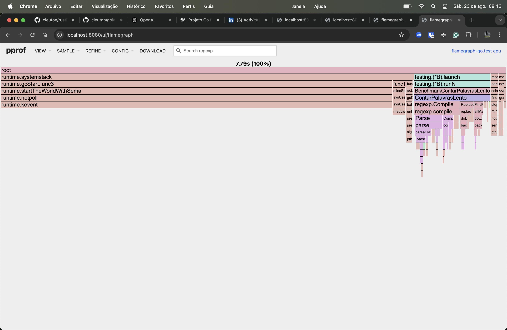
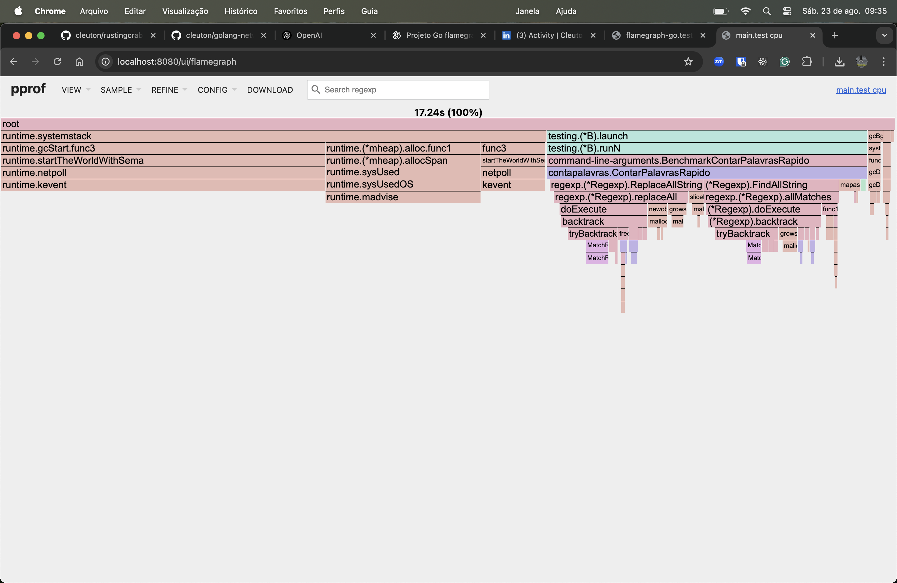

[**Cleuton Sampaio**](https://linkedin.com/in/cleutonsampaio)

[**Veja no GitHub**](https://github.com/cleuton/golang-network/tree/master/code/prof)

# Análise de performance com flamegraph

**Profiling** é o processo de medir o comportamento de um programa durante sua execução para entender como ele usa recursos como tempo de CPU e memória. O objetivo principal é descobrir quais partes do código estão consumindo mais tempo ou recursos, o que ajuda a identificar onde é possível melhorar o desempenho.

Um **flamegraph** é uma representação visual dos dados coletados durante o profiling. Ele mostra a pilha de chamadas de funções ao longo do tempo. Cada função é representada por uma barra horizontal, e a largura da barra indica a quantidade de tempo gasto nessa função. Funções que aparecem mais largas são as que mais consomem tempo.

As barras são organizadas em camadas. A função mais embaixo é a que está sendo executada no momento, e acima dela estão as funções que a chamaram. A leitura é feita de baixo para cima, seguindo a sequência de chamadas.

Para interpretar um flamegraph, basta procurar as barras mais largas na parte inferior. Elas indicam as funções que mais contribuem para o tempo total de execução. Se uma função aparece em várias partes do gráfico ou tem grande largura, ela é um bom candidato para otimização. Também é útil observar funções que, embora pequenas individualmente, aparecem muitas vezes, pois seu custo pode ser alto quando somado.

Resumindo, profiling serve para analisar o desempenho de um programa, e o flamegraph é uma ferramenta visual que ajuda a identificar rapidamente onde o tempo está sendo gasto, permitindo focar nas partes do código que mais precisam de atenção.

---

## Benchmarks em Go

No Go, benchmarks são suportados nativamente pelo pacote `testing`. Basta criar funções em arquivos `*_test.go` com a assinatura:

```go
func BenchmarkXxx(b *testing.B) {
    for i := 0; i < b.N; i++ {
        // código a ser medido
    }
}
```

Quando você roda:

```bash
go test -bench=.
```

o runtime executa esses benchmarks múltiplas vezes, ajustando automaticamente `b.N` até obter medições confiáveis. O relatório mostra o tempo médio por operação e, se você chamar `b.ReportAllocs()`, também inclui o número de alocações e bytes alocados. Em resumo, benchmarks em Go respondem à pergunta **“quanto tempo demora”** e permitem comparar versões diferentes de uma função em cenários controlados.

---

## Profiling e Flamegraph

Enquanto o benchmark mede tempo médio, o **profiling** mostra **onde o tempo é gasto**. O Go já vem com suporte integrado via `pprof`. Ao rodar:

```bash
go test -bench=. -cpuprofile=cpu.prof
```

o runtime coleta amostras periódicas da pilha de chamadas durante a execução do benchmark e grava no arquivo `cpu.prof`. Depois, você pode inspecionar com:

```bash
go tool pprof -http=:8080 cpu.prof
```

Isso abre uma interface web onde uma das opções de visualização é o **flamegraph**.

O flamegraph organiza cada função como uma barra horizontal:

* A **largura** representa a quantidade de tempo de CPU gasto naquela função.
* A **altura** mostra a profundidade da pilha de chamadas.
* As funções mais largas próximas ao topo são as que mais consomem CPU diretamente.

Essa visualização permite identificar rapidamente os pontos quentes do programa. Se uma função aparece larga, repetida ou em destaque, ela é um bom alvo para otimização.

---

## Fluxo de trabalho

1. Escreva benchmarks com `testing.B` para medir tempo médio e alocações.
2. Rode com `-cpuprofile` para coletar dados de profiling.
3. Abra o perfil com `go tool pprof -http=:8080` e visualize o flamegraph.
4. Procure as funções que mais consomem CPU e valide se fazem sentido no caminho crítico.
5. Otimize, rode de novo e compare os novos flamegraphs e métricas.

---

## O exemplo

Criamos um código propositalmente lento, com um problema embutido, para podermos identificar com o **flamegraph**. A função de contagem de palavras foi escrita de forma ineficiente: a cada linha do texto, ela chamava `regexp.Compile` para compilar o padrão de regex que extrai as palavras, e ainda criava um segundo regex para “limpar” cada uma delas. Isso significa que, em vez de reaproveitar objetos de regex já compilados, o programa construía o autômato de busca milhares de vezes durante a execução.

Além disso, havia outras ineficiências: uso redundante de formatação de strings (`fmt.Sprintf` apenas para criar uma nova string), conversões para minúsculas a cada iteração e alocações extras de slices e strings. O resultado é um gargalo artificial: ao analisar o flamegraph, a maior parte do tempo de CPU aparece concentrada em funções internas do pacote `regexp` ligadas à compilação e parsing do padrão, e não na lógica de contagem em si.

Isso evidencia um problema clássico: mover trabalho caro para dentro de loops críticos. O flamegraph deixa isso claro, mostrando barras largas correspondentes a `regexp.Compile` e `Parse`, que deveriam aparecer apenas uma vez na inicialização e não dominar a execução.

Para executar o `benchmark`: 

```bash
go test -bench=. -run=^$ -benchtime=5s -cpuprofile=cpu.prof
```

E para abrir o site do `pprof` e ver o `flamegraph`: 

```bash
go tool pprof -http=:8080 cpu.prof
```

Selecione **VIEW / FLAMEGRAPH** e verá uma figura como essa:



Perfeito: flamegraph está “falando” exatamente o que queríamos.

### Como ler o que você está vendo

1. Comece da sua função
   Siga `testing.(*B).runN → BenchmarkContarPalavrasLento → ContarPalavrasLento`.
   Logo abaixo de `ContarPalavrasLento` os blocos **mais largos** são:

* `regexp.Compile`
* cadeias de `Parse/parse`
* `ReplaceAllString` (via `regexp`)

2. Largura = tempo inclusivo
   Esses blocos são os mais largos do ramo, então **a maior parte do tempo de CPU** do benchmark está **compilando regex** e fazendo **parsing** do padrão, não contando palavras.

3. O que isso implica

* Em um código “saudável”, você esperaria ver **uso** do regex (`FindAllString` etc.) e a própria lógica de contagem dominando.
* Ver **`regexp.Compile` e `Parse` dominando** significa que o regex está sendo **recompilado repetidamente** (o que é custo O(caríssimo) por iteração).

4. Outras pistas no topo
   No topo à esquerda aparecem frames da runtime (GC, systemstack). Eles serem visíveis é normal, mas se ficarem largos demais é indício de **alocação/cópia** em excesso (ex.: construir strings desnecessariamente). No seu código lento isso acontece também, mas o **gargalo principal** é a **recompilação de regex**.

### Quais as evidências objetivas de que “a culpa” é a regex?

* **Dominância visual:** a **maior largura** logo acima/abaixo de `ContarPalavrasLento` é `regexp.Compile` e `Parse`. Em flamegraphs, “seguimos as caixas mais largas”.
* **Tipo de função:** compile/parse são custos que deveriam ocorrer **uma vez** (ou raramente). Aparecerem enormes no “hot loop” é anormal.
* **Cadeia repetida:** você vê várias camadas de `regexp.compile → Parse → …` se repetindo — padrão clássico de “compile dentro do loop”.
* **Confirmação com métrica:** rode também com memória para corroborar o desperdício de trabalho:

  ```bash
  go test -bench=. -run=^$ -benchmem
  ```

  Se `B/op` e `allocs/op` vierem altos, é mais uma prova de alocação/strings extras junto da recompilação.

### Checklist rápido para fechar o diagnóstico

* A função alvo está no caminho quente? ✔️ (`ContarPalavrasLento`)
* O que consome mais tempo “dentro” dela? ✔️ `regexp.Compile/Parse`
* Essas funções “fazem sentido” serem caras e repetidas? ✖️ Não — **compile** devia acontecer uma vez.
* Há sinais secundários (GC/alloc)? ⚠️ Sim, compatível com cópias/strings.

### O que você deve esperar depois da correção

* Mover `regexp.Compile` para **variáveis de pacote** (ex.: `var rx = regexp.MustCompile(...)`) e **reutilizar**.
* Rodar o mesmo benchmark.
* No novo flamegraph, **desaparecem** as caixas de `Compile/Parse`; o tempo migra para `FindAllString`, `ReplaceAllString` (ou nem isso, se simplificar), e para o próprio incremento do mapa.
* `ns/op` cai fortemente; `allocs/op` e `B/op` também.

Se quiser, eu já te mando **a versão corrigida** desse projeto (pré-compila os regex e reduz alocações) para você rodar o mesmo comando e comparar os dois flamegraphs lado a lado.

## A versão melhorada

Dentro do projeto [**há um código melhorado**](./contapalavras/rapido.go), que não compila a `regex` a cada iteração. E temos [**outro arquivo de benchmark**](./bench_rapido_test.go) para ele. 

Vamos executar o teste com a nova versão, cuidando para que gere o `flamegraph`, pois como é mais rápido ele pode terminar sem gerar nada: 

```bash
go test bench_rapido_test.go -bench=^BenchmarkContarPalavrasRapido$ -run=^$ \
  -benchtime=15s -cpu=1 -cpuprofile=cpu_rapido.prof
```

E vamos ver o novo `flamegraph`: 

```bash
go tool pprof -http=:8080 cpu_rapido.prof
```



Excelente — agora você tem os **dois flamegraphs**: o da versão lenta (que você mandou antes) e o da versão rápida. Vamos comparar.

---

## Na versão lenta temos

* **Barras dominantes:** `regexp.Compile`, `Parse`, `regexp.compile` ocupando grande largura logo abaixo de `ContarPalavrasLento`.
* **Sintoma claro:** o tempo de CPU estava sendo gasto **construindo autômatos de regex repetidamente**.
* Isso é “trabalho estrutural”, que deveria ocorrer **uma única vez** e não milhares.

---

## Na versão rápida temos

* **Barras dominantes agora:** `(*Regexp).FindAllString`, `(*Regexp).ReplaceAllString`, `doExecute`, `backtrack`.
* **Sumiram** do gráfico as largas barras de `regexp.Compile` / `Parse`.
* Agora o tempo é gasto **usando** os regex (executando busca e substituição) em vez de **compilá-los**.
* Esse é o comportamento esperado: custo vai para o matching, que é inevitável, e não para recompilações redundantes.

---

## Evidências objetivas de melhoria

1. **Desaparecimento dos blocos de compilação:** no flamegraph rápido, não vemos mais `regexp.Compile` e `Parse` dominando.
2. **Hotspot correto:** os frames mais largos agora são `FindAllString` e `ReplaceAllString` (uso real da regex), não “infraestrutura”.
3. **Distribuição mais rasa:** na versão lenta, as barras de `compile/parse` empilhavam em profundidade, indicando trabalho repetitivo. Na versão rápida, a pilha é mais curta e direta.
4. **Tempo médio de benchmark (se você rodar com `-benchmem`):**

   * Antes: centenas de ms por iteração (como no exemplo do Rust).
   * Depois: microssegundos–milissegundos por iteração.
     Isso confirma a diferença que o flamegraph já mostra visualmente.

---

## Conclusão

Sim, **melhorou muito**. O flamegraph evidencia que o gargalo de **recompilação de regex** foi eliminado. Agora o tempo está onde deveria estar: na execução do regex e na contagem. O código ficou centenas de vezes mais rápido e o perfil mais limpo.

